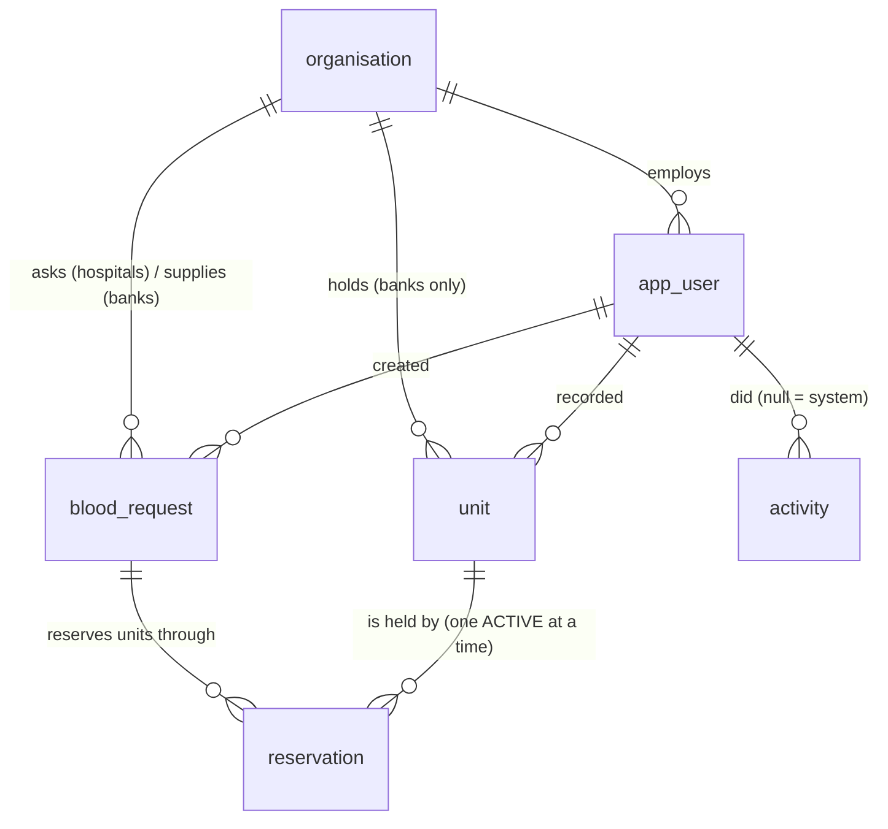

# BloodLink data model

Schema: `src/main/resources/db/changelog/changes/001-core.sql` (Liquibase, one changeset per object, each reversible).
PostgreSQL 18 (production runs 18.6 on Neon; every test runs on 18). Allowed values match the enums in `contract/openapi.yaml` exactly.

## Tables

| Table | Holds | Key rules enforced by the database |
| --- | --- | --- |
| `organisation` | Blood banks and hospitals | Type is `BLOOD_BANK` or `HOSPITAL` |
| `app_user` | Demo accounts | Email unique and lower-case; staff must belong to an organisation, donors and the administrator must not |
| `unit` | One row per blood unit (bag) | One known state at a time; group, rhesus, component and expiry required; expiry after collection; only a blood bank can hold units; reference unique within its bank |
| `blood_request` | A hospital's request to one bank | Never any patient detail (no column for one); bank must be a blood bank and hospital a hospital; quantity 1 to 20; a declined request always has its reason; one request per user and idempotency key |
| `reservation` | Links a request to one unit, with a hold expiry | **At most one ACTIVE reservation per unit** (`reservation_one_active_hold_idx`); an ACTIVE reservation has no end time, every other status has one |
| `donation_slot` | A time at a blood bank when donors can give, with a capacity | Only a blood bank; ends after it starts and within 8 hours; capacity 1 to 50; one slot per user and idempotency key |
| `booking` | A donor's place in a slot | **Never more active bookings than places** (`booking_one_active_per_place_idx` with `place_no BETWEEN 1 AND slot_capacity`, ADR-006); one active booking per donor per slot; the capacity copied onto the booking must match the slot (foreign key) |
| `activity` | History of units and requests | Append-only: a trigger refuses any edit or delete, so corrections are new rows and both stay visible |

## How "one unit, one reservation" holds under concurrent use

Three layers, so that removing any single one is caught by a test:

1. **Partial unique index** `reservation_one_active_hold_idx ON reservation (unit_id) WHERE status = 'ACTIVE'`.
   The database itself refuses a second active hold on a unit. This is the backstop.
2. **Guarded state change** in the approval transaction: `UPDATE unit SET state = 'RESERVED' WHERE id = ? AND state = 'AVAILABLE'`.
   Zero rows updated means someone else got there first, and the request is refused with 409.
3. **`SELECT ... FOR UPDATE SKIP LOCKED`** when choosing units, so concurrent approvals do not queue on the same row.

Measured on 2026-10-25 (three connections racing the approval SQL, 5 rounds each): with the protection, one success and
two refusals every round, one active hold; with all three layers removed, three successes every round, three active
holds on one unit. `ConcurrentApprovalIT` repeats this through the HTTP service in CI; see `docs/evidence.md`.

Reservations and requests have status views like units (`004-request-status.sql`): an ACTIVE reservation past its hold
shows `LAPSED`, one whose unit has expired shows `UNIT_EXPIRED`, and an APPROVED request with nothing held shows
`LAPSED` (or `UNIT_EXPIRED`).

## What a unit's state really is: the `unit_status` view

The stored state can lag behind the clock: a unit stays `RESERVED` after its hold lapses until something releases it,
and `AVAILABLE` after its expiry date until the expiry job marks it. Every read therefore uses `effective_state` from
the `unit_status` view (`003-unit-status.sql`):

| Stored state | Situation | Shown as |
| --- | --- | --- |
| `AVAILABLE` or `RESERVED` | expiry date has passed (Lagos date) | `EXPIRED` |
| `RESERVED` | no ACTIVE reservation whose hold is still running | `AVAILABLE` |
| anything else | | as stored |

So a lapsed hold is never shown as held, even if the background job has not run for an hour. Reading never changes
stored data; write paths and the jobs make the change for real. Dates are Lagos dates: every database connection runs
`SET TIME ZONE 'Africa/Lagos'`.

## Indexes and the queries they serve

| Index | Serves |
| --- | --- |
| `unit_available_idx` (group, rhesus, component, bank, expiry) `WHERE state = 'AVAILABLE'` | Availability search; approval picking units |
| `unit_reserved_idx` (group, rhesus, component, bank) `WHERE state = 'RESERVED'` | The "lapsed hold" half of availability search and approval |
| `unit_bank_expiry_idx` (bank, expiry) | A bank's unit list; the expiry sweep |
| `blood_request_hospital_idx` (hospital, created_at desc) | A hospital's requests, newest first |
| `blood_request_bank_newest_idx` (bank, created_at desc, id) | Requests addressed to a bank, newest first (replaced `blood_request_bank_idx` on 30 Oct, see below) |
| `reservation_one_active_hold_idx` (unit) `WHERE status = 'ACTIVE'` | The key rule, and "is this unit held?" |
| `reservation_request_idx` (request) | A request's reservations; each request's state in `blood_request_status` |
| `reservation_active_hold_expiry_idx` (hold_expires_at) `WHERE status = 'ACTIVE'` | The hold-lapse sweep; "holds ending soon"; live holds in availability search |
| `activity_entity_idx` (entity type, entity id, at) | A unit's or request's history |
| `activity_at_idx` (at desc) | Recent activity on the dashboard |
| `donation_slot_starts_idx` (starts_at, bank) | Donation slots in a date range |
| `booking_one_active_per_place_idx`, `booking_one_active_per_donor_idx` (slot, …) `WHERE status IN ('BOOKED', 'ATTENDED')` | Slot capacity and one booking per donor (ADR-006); places taken per slot |
| `booking_donor_idx` (donor, created_at desc) | A donor's bookings |

### Index analysis: the five most important queries

Measured on 30 Oct with `EXPLAIN (ANALYZE, BUFFERS)` on PostgreSQL 16, each query exactly as the service sends it, on
generated data at two sizes so growth shows. Reproduce with `scripts/index-analysis/`: `generate.sql` (`-v scale=1` or
`10`), then `queries.sql`, and `before.sql` for the old versions.

| Data | Scale 1 | Scale 10 |
| --- | --- | --- |
| Units | 50,068 | 500,068 |
| Requests | 10,024 | 100,024 |
| Reservations (live holds) | 7,485 (427) | 74,369 (4,162) |
| Donation slots / bookings | 22,884 / 91,201 | 219,984 / 879,601 |
| Activity rows | 70,145 | 700,145 |
| Banks / hospitals | 30 / 30 | 30 / 30 |

"Examined" is the rows the plan read from indexes and tables to produce the answer; "returned" is the rows the query
needed before grouping or paging.

| # | Query (endpoint) | Index serving it | Examined → returned, scale 1 | Examined → returned, scale 10 | Time 1 → 10 | Degrades as tables grow? |
| --- | --- | --- | --- | --- | --- | --- |
| 1 | Availability search, O negative red cells (`GET /availability`) | `unit_available_idx` + `unit_reserved_idx` (BitmapOr); live holds from `reservation_active_hold_expiry_idx` | 41 → 37 units, plus 427 live holds | 332 → 307 units, plus 4,162 live holds | 0.8 → 4.0 ms | Grows with the units that match, which is the answer itself, and with live holds, which inventory bounds. Not with history: expired and issued units are outside both partial indexes |
| 2 | Approval picks the units to hold (`POST /requests/{id}/approval`, `FOR UPDATE SKIP LOCKED`, 2 units) | `unit_available_idx` (bank, group, rhesus, component, ordered by expiry) | 1 → 1 | 1 → 1 | 0.11 → 0.10 ms | No. It reads only units of the asked type at that bank and stops at the number asked for |
| 3 | A bank's requests, newest first, first page of 20 (`GET /requests` as bank staff) | `blood_request_bank_newest_idx`; each row's state from `reservation_request_idx` | 20 → 20 requests (plus each one's few reservations) | 20 → 20 | 0.43 → 0.25 ms | No. It reads the page shown. **Before the fix: 30 → 335 ms**, reading every unit and reservation in the system |
| 4 | Holds ending in the next 60 minutes, every bank (`GET /dashboard`, list of 100) | `reservation_active_hold_expiry_idx` | 104 → 100 | 1,002 → 100 | 2.0 → 14.3 ms | Grows with the holds ending in the next hour (the sort needs them all), not with the tables. **Before the fix: 14 → 161 ms**, every unit and reservation |
| 5 | Donation slots in the next 14 days with places left (`GET /donation-slots`) | `donation_slot_starts_idx`; places taken from `booking_one_active_per_donor_idx` (index-only) | 984 slots + 4 bookings each → 984 | 984 + 4 each → 984 | 7.1 → 9.7 ms | No. Past slots and their bookings are outside the date range; it reads the next 14 days only |

The scale-10 database is ten times larger in every table that grows with use. The query that read the whole history
(3, before) slowed eleven times; the others either stay flat (2, 3, 5) or grow with the answer (1, 4).

#### Three fixes the analysis led to (30 Oct)

1. **`blood_request_status` asks the tables directly** (migration 009). It used to read each reservation's state through
   `reservation_status`, which joins every unit; PostgreSQL could not push "only this request's reservations" through
   it, so listing 20 requests built the state of all 500,000 units first. The view now counts the request's own
   reservations through `reservation_request_idx`. Same rule, same answers: `ViewEquivalenceIT` compares every request
   against the original rule and finds no difference (the seed covers PENDING, APPROVED, LAPSED and UNIT_EXPIRED).
2. **`blood_request_bank_idx` (bank, state, created_at) replaced by (bank, created_at, id)**. The list filters on the
   *effective* state, which the view computes, so the stored `state` in the middle of the old index meant it could not
   give rows newest first; PostgreSQL read all 3,340 of the busiest bank's requests and sorted them. The new index gives
   the page in order and stops after 20.
3. **The dashboard's "holds ending soon" reads `reservation` directly** with the same conditions the view applies
   (active, not yet lapsed, unit not expired), so `reservation_active_hold_expiry_idx` serves it.

#### A fourth finding: prepared statements and optional filters

Queries take optional filters as `CAST(:x AS ...) IS NULL OR column = :x`. After five runs the PostgreSQL driver
prepares the statement on the server, and PostgreSQL may then reuse one *generic* plan for every set of values. A
generic plan cannot drop the unused filters, so availability search used the wrong index and read every available unit:

| Availability search, prepared | Scale 1 | Scale 10 |
| --- | --- | --- |
| Generic plan | 22 ms, 4,367 units × 30 banks | 177 ms, 43,278 units × 30 banks |
| Plan for the actual values | 0.3 ms, 37 units | 2.3 ms, 307 units |

Every connection now sets `plan_cache_mode = force_custom_plan` (`application.yml`, `connection-init-sql`), so each run
is planned for its real values. Planning costs under 1 ms here.

**Index deliberately not created:** none on `unit (state)` alone. Only five values exist, and most units at any time are
ISSUED or EXPIRED history, so an index on state would point at hundreds of thousands of rows for those and still need
the blood group and component checked one by one for AVAILABLE. The partial `unit_available_idx` and `unit_reserved_idx`
already cover the two states that are searched, with the search terms in the index; a plain state index would only add
work to every unit change. At scale 10, 87% of units are ISSUED or EXPIRED (434,517 of 500,068).

## Still to add

The dashboard reads existing tables; no new table is planned.
