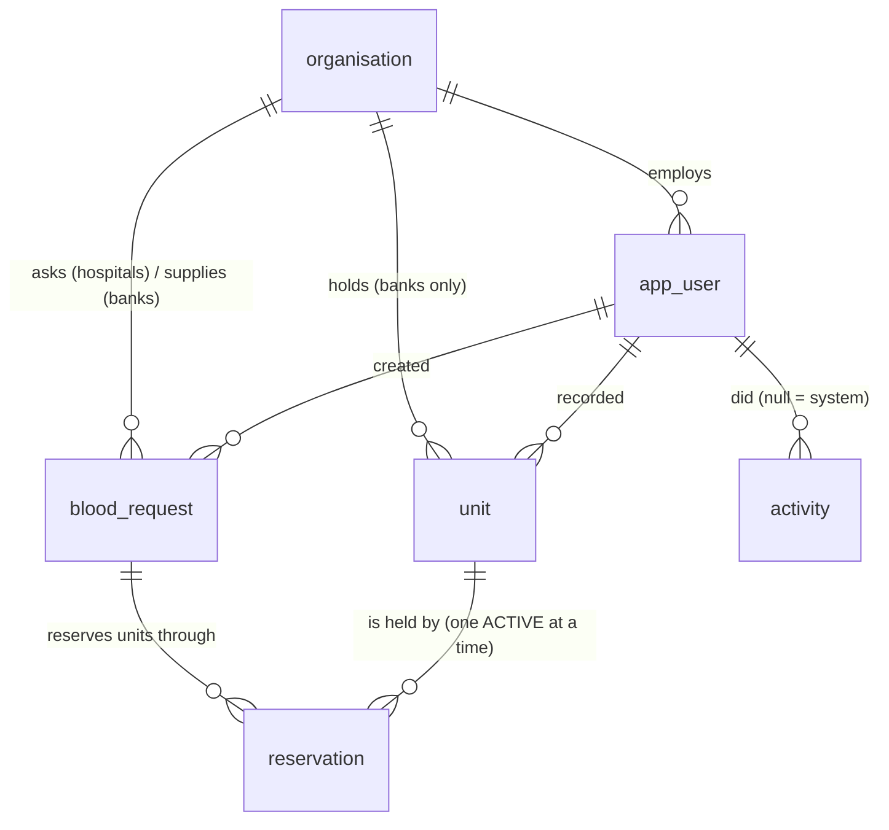

# BloodLink data model

Schema: `src/main/resources/db/changelog/changes/001-core.sql` (Liquibase, one changeset per object, each reversible).
PostgreSQL 17. Allowed values match the enums in `contract/openapi.yaml` exactly.

## Tables

| Table | Holds | Key rules enforced by the database |
| --- | --- | --- |
| `organisation` | Blood banks and hospitals | Type is `BLOOD_BANK` or `HOSPITAL` |
| `app_user` | Demo accounts | Email unique and lower-case; staff must belong to an organisation, donors and the administrator must not |
| `unit` | One row per blood unit (bag) | One known state at a time; group, rhesus, component and expiry required; expiry after collection; only a blood bank can hold units; reference unique within its bank |
| `blood_request` | A hospital's request to one bank | Never any patient detail (no column for one); bank must be a blood bank and hospital a hospital; quantity 1 to 20; a declined request always has its reason; one request per user and idempotency key |
| `reservation` | Links a request to one unit, with a hold expiry | **At most one ACTIVE reservation per unit** (`reservation_one_active_hold_idx`); an ACTIVE reservation has no end time, every other status has one |
| `activity` | History of units and requests | Append-only: a trigger refuses any edit or delete, so corrections are new rows and both stay visible |

## How "one unit, one reservation" holds under concurrent use

Three layers, so that removing any single one is caught by a test:

1. **Partial unique index** `reservation_one_active_hold_idx ON reservation (unit_id) WHERE status = 'ACTIVE'`.
   The database itself refuses a second active hold on a unit. This is the backstop.
2. **Guarded state change** in the approval transaction: `UPDATE unit SET state = 'RESERVED' WHERE id = ? AND state = 'AVAILABLE'`.
   Zero rows updated means someone else got there first, and the request is refused with 409.
3. **`SELECT ... FOR UPDATE SKIP LOCKED`** when choosing units, so concurrent approvals do not queue on the same row.

Measured on 2026-10-25 (three connections racing the approval SQL, 5 rounds each): with the protection, one success and
two refusals every round, one active hold; with all three layers removed, three successes every round, three active
holds on one unit. `ConcurrentApprovalIT` repeats this through the HTTP service in CI; see `docs/evidence.md`.

Reservations and requests have status views like units (`004-request-status.sql`): an ACTIVE reservation past its hold
shows `LAPSED`, one whose unit has expired shows `UNIT_EXPIRED`, and an APPROVED request with nothing held shows
`LAPSED` (or `UNIT_EXPIRED`).

## What a unit's state really is: the `unit_status` view

The stored state can lag behind the clock: a unit stays `RESERVED` after its hold lapses until something releases it,
and `AVAILABLE` after its expiry date until the expiry job marks it. Every read therefore uses `effective_state` from
the `unit_status` view (`003-unit-status.sql`):

| Stored state | Situation | Shown as |
| --- | --- | --- |
| `AVAILABLE` or `RESERVED` | expiry date has passed (Lagos date) | `EXPIRED` |
| `RESERVED` | no ACTIVE reservation whose hold is still running | `AVAILABLE` |
| anything else | | as stored |

So a lapsed hold is never shown as held, even if the background job has not run for an hour. Reading never changes
stored data; write paths and the jobs make the change for real. Dates are Lagos dates: every database connection runs
`SET TIME ZONE 'Africa/Lagos'`.

## Indexes and the queries they serve

The full analysis (rows examined versus returned, and behaviour as tables grow) is due on Fri 30 Oct.

| Index | Serves |
| --- | --- |
| `unit_available_idx` (group, rhesus, component, bank, expiry) `WHERE state = 'AVAILABLE'` | Availability search |
| `unit_reserved_idx` (group, rhesus, component, bank) `WHERE state = 'RESERVED'` | The "lapsed hold" half of availability search |
| `unit_bank_expiry_idx` (bank, expiry) | A bank's unit list; the expiry sweep |
| `blood_request_hospital_idx` (hospital, created_at desc) | A hospital's requests, newest first |
| `blood_request_bank_idx` (bank, state, created_at desc) | Requests addressed to a bank, by state |
| `reservation_one_active_hold_idx` (unit) `WHERE status = 'ACTIVE'` | The key rule, and "is this unit held?" |
| `reservation_request_idx` (request) | A request's reservations |
| `reservation_active_hold_expiry_idx` (hold_expires_at) `WHERE status = 'ACTIVE'` | The hold-lapse sweep; "reservations about to lapse" |
| `activity_entity_idx` (entity type, entity id, at) | A unit's or request's history |
| `activity_at_idx` (at desc) | Recent activity on the dashboard |

### Measured: availability search on 50,000 units

`GET /availability?bloodGroup=O&rhesus=NEGATIVE&component=RED_CELLS`, PostgreSQL 16, 50,000 units across three banks,
measured on 2026-10-25:

| | |
| --- | --- |
| Plan | `BitmapOr` of `unit_available_idx` and `unit_reserved_idx`; no table scan |
| Rows examined | 417 |
| Rows returned (before grouping) | 417 |
| Time | 1.3 ms |
| As the table grows | Rows examined track the matching units, not the table size, because both indexes are partial and filtered on the search terms |

**Index deliberately not created:** none on `unit (state)` alone. Only five values exist, so it would rarely narrow a search enough to be used,
and the partial `unit_available_idx` already covers the one state that is searched heavily.

## Still to add

Donation slots and bookings (with a capacity rule), in a later changeset.
