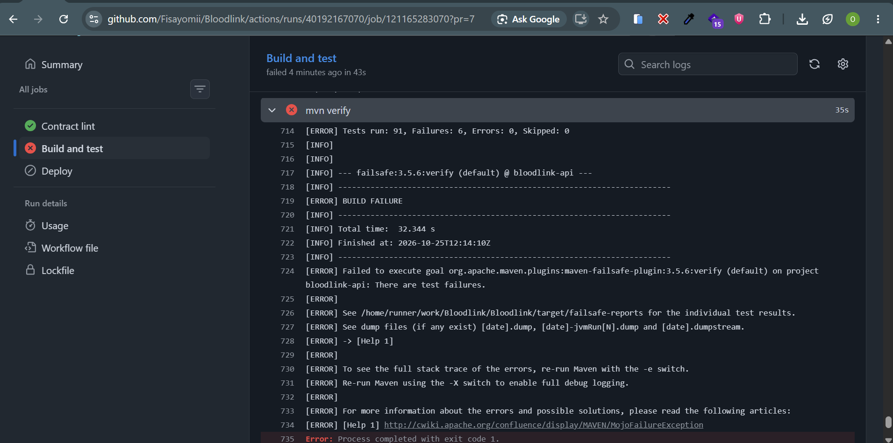
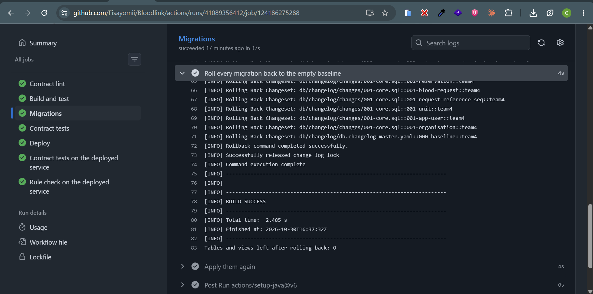
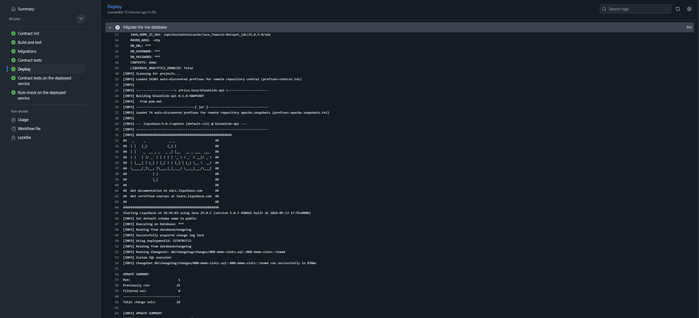

# Evidence: the reservation rule fails without its protection

The brief: "An automated test that performs the two conflicting operations at the same moment against the deployed
service and asserts that exactly one succeeded. The team then removes the protection and records the same test failing.
A test that passes both before and after proves nothing and earns nothing."

## The test

`src/test/java/africa/tesa/bloodlink/request/ConcurrentApprovalIT.java`. Each round puts exactly one O-negative red-cell
unit in a bank, has three hospitals (Yaba, Ikorodu, Victoria Island) request it, then releases the bank's three
approvals at the same instant through the real HTTP service. It asserts one 201, two 409 `UNITS_NO_LONGER_AVAILABLE`,
exactly one ACTIVE reservation on the unit, and the two losing requests still PENDING. Five rounds.

## The protection (three layers, in `RequestService.approve`)

1. `SELECT ... FOR UPDATE OF u SKIP LOCKED` when choosing units.
2. `UPDATE unit SET state = 'RESERVED' WHERE id IN (...) AND state = 'AVAILABLE'`, refused if fewer rows change.
3. Partial unique index `reservation_one_active_hold_idx ON reservation (unit_id) WHERE status = 'ACTIVE'`.

## How the failing run is produced (never merged)

Apply `EVIDENCE-ONLY-remove-reservation-protection.patch` on a throwaway branch. It removes all three layers and adds a
0.2-second pause between reading the unit and reserving it. The pause is declared here because it only widens the
window in which the race happens; it does not create the race. Without the protection, three approvals that read the
unit before any of them writes will all reserve it.

```powershell
git checkout main
git pull
git checkout -b evidence/no-protection
git am "$HOME\Downloads\EVIDENCE-ONLY-remove-reservation-protection.patch"
git push -u origin evidence/no-protection
```

Open a **draft** pull request from `evidence/no-protection`. CI runs and **Build and test** goes red:
`ConcurrentApprovalIT` reports three 201s and three ACTIVE reservations on one unit, and `SchemaRulesIT` reports that a
second ACTIVE hold was accepted. Screenshot the failing check and the test report, save them under `docs/evidence/`,
then close the pull request without merging and delete the branch.

## Results

| Date | Run | Protection | Result | Link |
| --- | --- | --- | --- | --- |
| 2026-10-25 | Local PostgreSQL 16, approval SQL raced by three connections, 5 rounds | On | 5/5 rounds: one 201, two 409, 1 active hold | |
| 2026-10-25 | Same, protection removed (all three layers) | Off | 5/5 rounds: three 201s, 3 active holds on one unit | |
| 2026-10-25 | CI, `ConcurrentApprovalIT`, every pull request and push to `main` | On | Green: 5/5 rounds, one 201, two 409, one active hold | Actions › api › Build and test on `main` https://github.com/Fisayomii/Bloodlink/actions/runs/40191021808 |
| 2026-10-25 | CI, `ConcurrentApprovalIT`, draft PR `evidence/no-protection` | Off | Expected red: three 201s, three active holds on one unit (record what the run shows) | https://github.com/Fisayomii/Bloodlink/actions/runs/40192167070  [screenshot](evidence/no-protection-red.png) |
| Every deploy | Deployed service, `scripts/race-deployed.mjs` (pipeline job "Rule check on the deployed service") | On | Expected: one 201, two 409, requests APPROVED, PENDING, PENDING | Actions › api › latest `main` run |

## Screenshots

### Protection removed: the test fails

Draft PR `evidence/no-protection`, **Build and test** red. `ConcurrentApprovalIT` reports three 201s and three
ACTIVE reservations on one unit.



### Protection on: the test passes

Same test on `main`, green: one 201, two 409s, one active hold, five rounds.


### Migrations run in the pipeline and can be reversed

**Migrations** job, every pull request: every migration applied to an empty PostgreSQL 17, all rolled back to the empty
baseline (0 tables left), then applied again.



**Deploy > Migrate the live database**: the pipeline migrates Neon before the new version starts. 25 migrations already
applied were recognised; only the demo-slot top-up ran.



## The slot capacity rule fails without its protection

The brief: "A donation slot cannot be booked beyond its capacity, including when two donors book the last place in the
same second."

**The test:** `src/test/java/africa/tesa/bloodlink/donation/ConcurrentBookingIT.java`. Through the real HTTP service:
two donors book the last place of a 3-place slot at the same instant (expects one 201, one 409 `SLOT_FULL`, 3 active
bookings), and ten donors book a 3-place slot at the same instant (expects three 201s, seven `SLOT_FULL`, three
distinct places). Five rounds each.

**The protection (ADR-006):** the place index `booking_one_active_per_place_idx` with `place_no BETWEEN 1 AND
slot_capacity` (`007-donation-slots.sql`), and the slot row lock in `DonationService.book`.

**How the failing run is produced (never merged):** apply `EVIDENCE-ONLY-remove-slot-capacity-protection.patch` on a
throwaway branch. It removes the place index and the slot lock, and adds a 0.2-second pause between choosing a place and
inserting the booking. The pause only widens the window in which the race happens; it does not create it.

```powershell
git checkout main
git pull
git checkout -b evidence/no-slot-protection
git am "$HOME\Downloads\EVIDENCE-ONLY-remove-slot-capacity-protection.patch"
git push -u origin evidence/no-slot-protection
```

Open a **draft** pull request. **Build and test** goes red: `ConcurrentBookingIT` reports more 201s than places and more
active bookings than the capacity, and `SchemaRulesIT.aSlotCanNeverHoldMoreActiveBookingsThanItHasPlaces` reports a
second booking on place 1 accepted. Screenshot it into `docs/evidence/`, close the pull request without merging, delete
the branch.

| Date | Run | Protection | Result | Link |
| --- | --- | --- | --- | --- |
| 2026-10-30 | Local PostgreSQL 16, booking SQL raced by six sessions for three places | Lock and index | 3 active bookings: full, never over | |
| 2026-10-30 | Same, slot lock removed | Index only | 1 active booking: never over capacity; the others found their place taken | |
| 2026-10-30 | Same, lock and index removed | Off | 6 active bookings on a 3-place slot | |
| | CI, `ConcurrentBookingIT`, every pull request and push to `main` | On | Expected green: one 201 and one `SLOT_FULL`; three of ten (record the run) | [green run](evidence/green-run.png) |
| | CI, draft PR `evidence/no-slot-protection` | Off | Expected red: more bookings than places (record what the run shows) | |

## Every rule and the test that fails without it

The brief: "Every business rule listed for your product has a test that fails when the rule is removed." Remove the
protection named in the middle column and the test on the right goes red.

| Business rule (brief) | Where it is protected | Test that fails without it |
| --- | --- | --- |
| A unit has one state at a time, from a fixed list; it needs a group, component, expiry and bank | `unit` CHECK constraints and NOT NULL, `001-core.sql` | `SchemaRulesIT.aUnitHasExactlyOneKnownState`, `aUnitCanOnlyBelongToABloodBank` |
| A unit is reserved for at most one request at a time, even with three at once | Three layers in `RequestService.approve` (ADR-001) | `ConcurrentApprovalIT` (red run above), `SchemaRulesIT.aUnitCanBeHeldByOnlyOneActiveReservation` |
| The losing hospital gets a clear refusal and its request stays usable | 409 `UNITS_NO_LONGER_AVAILABLE`, request stays PENDING | `ConcurrentApprovalIT`, `ApprovalIT.approvalIsAllOrNothing` |
| An expired unit cannot be reserved or issued | `expiry_date >= current_date` in approval and issue | `ApprovalIT.anExpiredUnitIsNeverReserved`, `IssueIT.anExpiredUnitCanNeverBeIssued` |
| A unit that expires while reserved reaches a defined final state; the request shows what happened | `reservation_status`, `blood_request_status` views | `SeedDataIT.twoUnitsExpiredWhileReservedAndEachReachedItsFinalState`, `IssueIT.anExpiredUnitCanNeverBeIssued` |
| A lapsed hold returns the unit to stock and is never shown as held, even if no job runs | `unit_status` view; approval releases lapsed holds | `UnitsIT.aReservedUnitWhoseHoldLapsedShowsAsAvailableBeforeAnyJobHasRun`, `ApprovalIT.aUnitWhoseHoldLapsedCanBeReservedForAnotherRequestAndTheFirstRequestShowsLapsed` |
| Only staff of the owning bank, or the administrator, change a unit's state | Role rules in `SecurityConfig`; bank checks in the services (another bank gets 404) | `RoleRulesIT`, `IssueIT.anotherBanksStaffCannotIssueAndAreToldItDoesNotExist`, `HoldReleaseIT.anotherBanksStaffCannotReleaseAndAreToldItDoesNotExist` |
| Only the requesting hospital can cancel its own request | `SecurityConfig` (hospital staff only) and `RequestLifecycleService.cancel` | `RoleRulesIT.bankStaffCannotCancelAHospitalsRequest`, `theAdministratorCannotCancelAHospitalsRequest`, `CancellationIT.anotherHospitalCannotCancelAndIsToldItDoesNotExist` |
| An issue recorded in error can be reversed; the unit returns to available only if it has not expired; both entries stay | `RequestLifecycleService.reverseIssue`; append-only `activity` trigger | `IssueIT.reversingAnIssueReturnsAnUnexpiredUnitToStockAndKeepsBothEntries`, `aReversedIssueDoesNotReturnAnExpiredUnitToStock`, `SchemaRulesIT.historyIsAppendOnly` |
| Two people acting on one request at once leave it consistent | Request row lock in every lifecycle change | `IssueOrCancelRaceIT` |
| Emergency and routine holds (design problem, ADR-002) | `RequestLifecycleService.releaseHoldFor` | `HoldReleaseIT` |
| Requests carry a reference and the hospital, never a patient name | No column; unknown body fields refused | `RequestsIT.aPatientNameIsRefused`, `SchemaRulesIT.requestsGetAReadableReference` |
| Submitting the same request twice records one | `blood_request_idempotency_key` + `ON CONFLICT DO NOTHING` | `RequestsIT.submittingTwiceWithTheSameKeyRecordsOneRequest`, `SchemaRulesIT.theSameIdempotencyKeyFromTheSameUserCreatesOnlyOneRequest` |
| Availability figures are derived and say when they were computed | Computed per request with `computedAt` | `AvailabilityIT.figuresSayWhenTheyWereComputedAndHowMatchingWorks` |
| A donation slot is never booked beyond its capacity, even with two donors at once | Next change (contract v0.2) | To come |
| A donation slot is never booked beyond its capacity, even when two donors book the last place in the same second | Place index and slot lock (ADR-006, `007-donation-slots.sql`, `DonationService.book`) | `ConcurrentBookingIT`, `SchemaRulesIT.aSlotCanNeverHoldMoreActiveBookingsThanItHasPlaces`, `BookingsIT.aFullSlotRefusesTheNextDonor` |
| A donor holds one place per slot; a cancelled place can be booked again | `booking_one_active_per_donor_idx`; partial indexes count only BOOKED and ATTENDED | `BookingsIT.bookingTheSameSlotAgainRecordsOneBooking`, `cancellingFreesThePlaceForAnotherDonor`, `SchemaRulesIT.aCancelledPlaceCanBeTakenAgainButADonorHoldsOnePlacePerSlot` |
| Only donors book, only bank staff open slots, only the donor cancels, only the slot's bank records attendance | `SecurityConfig` role rules; `DonationService` (another donor or bank gets 404) | `RoleRulesIT.onlyDonorsBookDonationSlots`, `onlyBankStaffOpenDonationSlots`, `donorsCannotRecordAttendance`, `BookingsIT.onlyTheDonorWhoBookedCanCancelAndOthersAreToldItDoesNotExist`, `anotherBanksStaffCannotRecordAttendanceAndAreToldItDoesNotExist` |
| Dashboard figures match the underlying records and show when they were computed | Figures derived on request from the `unit_status`, `reservation_status` and `blood_request_status` views, one snapshot, `computedAt` | `DashboardIT.stockFiguresMatchTheRecordsAndSayWhenTheyWereComputed`, `openRequestsAndHoldsEndingSoonComeFromTheRequests` |
| The background job only writes down what reads already show; a busy request is left for the next run | `HoldAndExpirySweep` (request row, then units, SKIP LOCKED) | `SweepIT.aLapsedHoldIsWrittenDownAndWhatUsersSeeDoesNotChange`, `aRequestSomeoneIsActingOnIsLeftForTheNextRun` |
| Only bank staff and the administrator see the dashboard; bank staff only their own bank | `SecurityConfig`; `DashboardService` ignores `bankId` for bank staff | `RoleRulesIT.onlyBankStaffAndTheAdministratorSeeTheDashboard`, `DashboardIT.bankStaffAlwaysSeeTheirOwnBankEvenIfTheyAskForAnother` |
